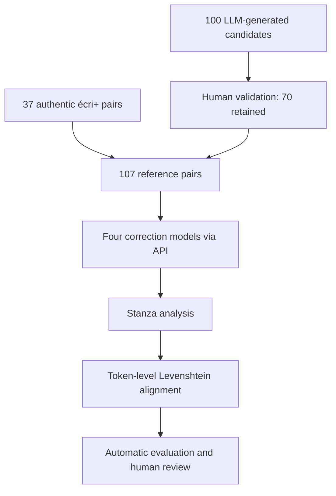

# French Grammatical Error Correction — LLM Evaluation

Master's research project (2025–2026), Université Grenoble Alpes, LIDILEM. Supervised by Olivier Kraif, in the context of DEEPER.

## Research objective

Evaluate whether LLMs can correct French relative-clause errors with minimal edits, without unnecessary reformulation. The study combines controlled corpus augmentation, linguistic analysis, token alignment and human review.

## Methodology



Generation models: GPT-5.5 Instant, DeepSeek-V4-Pro Preview, Gemini 3.5 Flash and Claude Sonnet 5, as reported in the thesis. Correction models: GPT-OSS-20B, DeepSeek-V4-Flash, Qwen3-32B and Gemma3-27B. Each correction model was evaluated on 107 sentences under a shared prompt (428 outputs in total). Gold corrections were not provided to the correction models.

## Results

| Model | Normalized exact match | Edit micro F1 | Acceptability after human review |
|---|---:|---:|---:|
| DeepSeek-V4-Flash | 81.31% | 82.03% | 85.05% |
| Gemma3-27B | 70.09% | 70.77% | 76.64% |
| Qwen3-32B | 67.29% | 68.83% | 74.77% |
| GPT-OSS-20B | 57.94% | 56.22% | 68.22% |

Results are historical experimental measurements, not a general model ranking. Thirty alternative corrections were accepted through manual review. All four models had higher exact-match rates on synthetic than authentic sentences. The corpus is small, uneven across categories, and a single reference may penalize valid alternatives.

Aggregate metrics exported from the original evaluation workbook are in [`results/`](results/). The acceptability table combines exact matches and manually accepted alternatives over all 107 sentences per model.

## Repository contents

- `inference/`: original API scripts, archived prompt and final inference input.
- `evaluation/data/corpus complet.xlsx`: consolidated research corpus with all 428 historical model outputs.
- `evaluation/result/`: original Stanza and alignment JSON files, alignment workbook and complete evaluation workbook with human annotations.
- `results/`: aggregate metrics extracted from the original evaluation workbook.
- `docs/master_thesis.pdf`: final submitted thesis (French).
- `docs/provenance.md`: source history, limitations and access restrictions.

## Corpus augmentation

| Generation model | Generated | Accepted | Acceptance |
|---|---:|---:|---:|
| ChatGPT | 25 | 24 | 96% |
| DeepSeek | 25 | 18 | 72% |
| Gemini | 25 | 18 | 72% |
| Claude | 25 | 10 | 40% |
| Total | 100 | 70 | 70% |

## Performance by data origin

| Correction model | Authentic écri+ | Synthetic |
|---|---:|---:|
| GPT-OSS-20B | 27.0% | 74.3% |
| DeepSeek-V4-Flash | 48.6% | 98.6% |
| Qwen3-32B | 37.8% | 82.9% |
| Gemma3-27B | 27.0% | 92.9% |

These normalized exact-match rates (thesis Table 10) illustrate the importance of data provenance and the risk of overestimating performance on controlled synthetic data.

## Setup and reproduction

Python 3.12 recommended. From the repository root:

```bash
python3.12 -m venv .venv
source .venv/bin/activate
python -m pip install -r requirements.txt
python -c "import stanza; stanza.download('fr')"
```

Re-run the evaluation of the archived model outputs without API calls. The commands below write to a separate directory to preserve the original research artifacts. The original evaluation workbook is copied first so that the script can retain manual annotations.

```bash
mkdir -p reproduction
cp evaluation/result/evaluation_llm.xlsx reproduction/evaluation_llm.xlsx
python evaluation/src/stanza_analysis.py --input "evaluation/data/corpus complet.xlsx" --output reproduction/stanza_analyses.json
python evaluation/src/alignment.py --stanza-json reproduction/stanza_analyses.json --input-excel "evaluation/data/corpus complet.xlsx" --output-json reproduction/alignments.json --output-excel reproduction/alignments.xlsx
python evaluation/src/evaluate_llm_results.py --input reproduction/alignments.xlsx --output reproduction/evaluation_llm.xlsx
```

For optional live inference, copy `inference/.env.example` to `inference/.env`, set your own HF_TOKEN, and run the relevant script from `inference/`. Provider access, cost and model availability may vary. Consolidation of the four outputs is a separate manual step; no consolidation script was found in the source archive. The original evaluation script recalculates edits from source and target strings; the scoring is distinct from the initial Stanza alignment. The historical environment is not fully locked, so reruns may differ. The evaluation workflow ran locally on an independent small fixture; the full archived corpus has not been rerun in this packaging. The published research figures above are historical, not fixture results.

## Attribution and access

Hongmin Xie, *Constitution et évaluation d’un corpus d’erreurs de subordonnées relatives corrigées par des LLM*, Master's thesis, 2026. Alignment implementation adapts the pseudocode of Lin Song (2025), as described in the thesis and archived README.

**Private research archive.** Contains authentic student sentences from écri+, model outputs, human annotations and the submitted thesis. Do not make public or distribute to third parties until the relevant corpus, code and thesis permissions are confirmed. Credentials and virtual environments are excluded. No license is asserted for third-party research materials.
